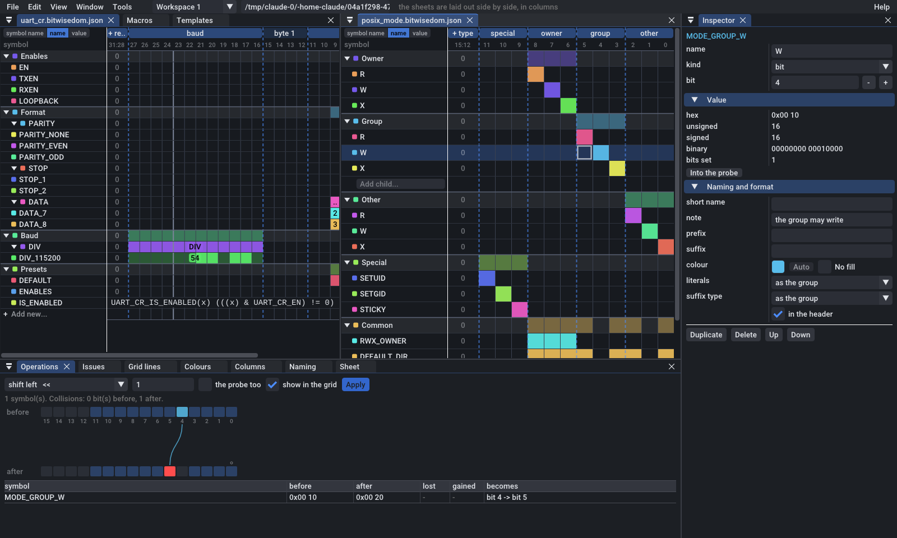
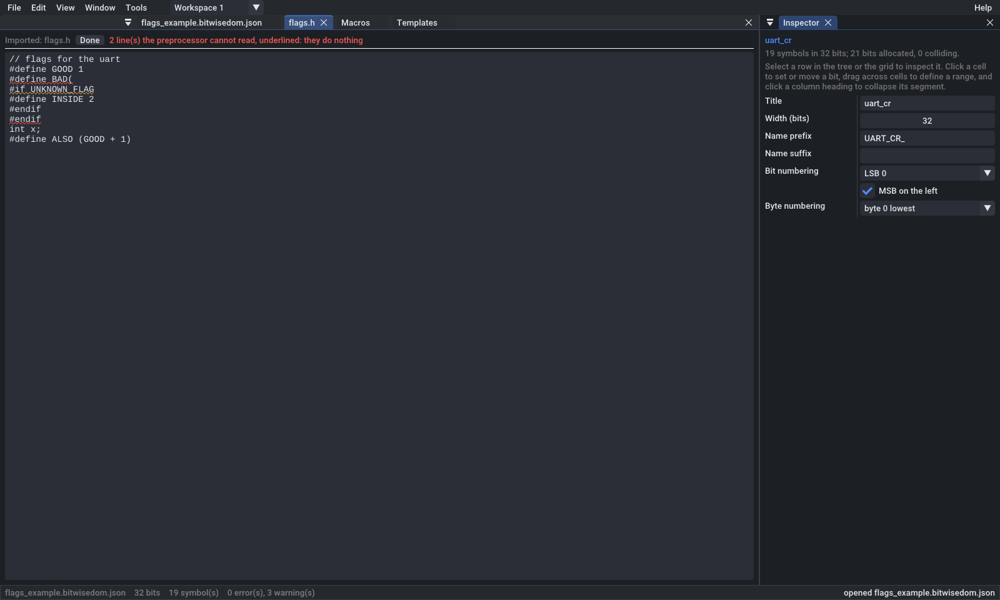
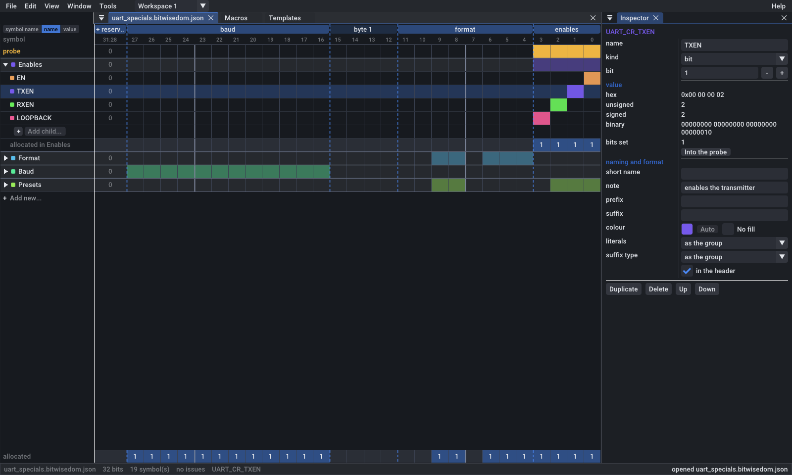
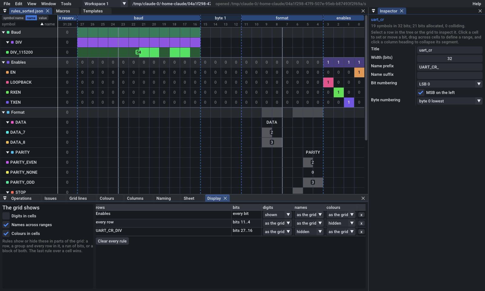

# bitwis(e)dom

A bitfield manager -- `bitwisedom` in code, on disk and on the command line. A **sheet** is a word of 1 to 64 bits -- or wider, to 65,536, held
in C as an array of words -- and a tree of **symbols**, each one row: a name
mapped to a value, shown across the bits it sets, and written out as a C or
C++ macro. Groups collapse like the nodes of a
tree, runs of columns collapse to one, and long names abbreviate to fit. An
operation -- a shift, a rotation, a byte swap, arithmetic -- is previewed as
the bits it moves and the collisions it makes before it is applied. Sheets
open side by side in windows that dock, in workspaces of their own.

It reads C as well as writing it: a header, or code pasted from one, becomes
a sheet, its macros evaluated as C evaluates them -- expanded in a define
environment, typed, and checked for what C would do wrong.

It is built on djinterp (the model's integers and bit functions come from
`re_std`, and C is read with its lexer), with its window drawn by uxoxo over
Dear ImGui. Building it is described in [BUILD.md](BUILD.md).


---

## The window

The window is laid out as Visual Studio's is: **windows that dock**. Each
sheet is open in a window of its own, its tab named for its file and marked
with a dot while it has unsaved changes; around the sheets are the **tool
windows** -- the Inspector down the right; the Macros and Templates pages
at the top, as tabs among the sheets; and below them Operations, Issues,
Grid lines, Colours, Columns, Naming, Sheet, Display and Console. A tool
window shows the sheet in front.

The sheets' **tabs sit over the bits**, as Visual Studio's code tabs sit
over the code: a sheet's symbols column runs up through the tab row, to
the window's top, and its tabs begin past it. **Double-click a sheet's
tab** to rename its file: the name is typed over the tab -- Enter, or a
click away, keeps it; Escape does not -- and `.bitwisedom.json` is put
after a name with no `.json` of its own. Nothing on the disk changes: the
sheet is marked changed, and Save writes it under its new name.

The **status bar** runs along the window's foot: what the sheet in front
is on the left -- its file, its width, its symbols, its issues and the row
selected -- and at the right end what the window last said, after a `*`
while the sheet has unsaved changes. **Click the message** for the
**Console**: every action taken so far, the latest first -- its name, what
it carried, the sheet it was taken in, and when -- an action repeated, a
slider dragged or a name typed, counted as one line many times over. Every
action is a named event with plain values, as a script will one day send
them; the console only lists them.

* **Drag a tab** to dock its window somewhere else -- beside, above or below
  another, or among its tabs, where the drop targets show -- or out on its
  own, floating. Drag the hairline between two windows to size them.
* **A tab's x** closes its window. A tool window comes back from **View >
  Tool windows**, where it was; a sheet with unsaved changes asks first.
* **Ctrl+J** puts the windows below the sheets away, and brings them back.
* **Window > Reset the layout** puts every window back where a new
  workspace has it.



**Workspaces** are the window's desktops, as Linux has several: each has
its own sheets, its own tool windows and its own layout of them, all kept
while another is in front. The list after the menus switches between them,
or adds one; the **Window** menu adds, renames, closes and moves a
sheet to another, and **Ctrl+Alt+Right** and **Ctrl+Alt+Left** step through
them. The Window menu also **arranges** a workspace's sheets: as tabs of
one window, side by side in columns, one above another in rows, or in a
grid as near square as their number allows.

**Zoom** is each window's own, as a browser's page's is: **Ctrl** and the
wheel over a window, or **Ctrl+=**, **Ctrl+-** and **Ctrl+0** for the one in
front, from half size to three times; View has them too, and puts every
window back at its actual size at once.

The window **opens where it was left**: its workspaces, every sheet in them
-- unsaved changes too -- the layout of its windows and their zoom. It
keeps them in `session.json` beside its settings file, as long as **Open
where I left off** is on, in the Options.

### The Options

**Tools > Options** (**Ctrl+,**) is every setting in one place, as Visual
Studio's are: the window's own on its first pages -- the theme and colour
scheme, opening where it was left, how the symbols tree is shown, how rows
are added, what ends a group's rows and how the Add node window opens --
and then the sheet's, page by page. The search above the
pages finds a setting by its name or what it does.

**Settings files** keep a set of settings to use again: **Export** writes
the window's settings and the sheet's preferences -- how it is drawn and
written, never what is in it -- to a file, and puts it on the list; a file
on the list is **applied** with a press, to the window and the sheet in
front. Import adds one from elsewhere. The list is remembered from one run
to the next for as long as each file is where it was; **Forget** takes one
off the list, and **Delete** deletes the file too. Tools > Import or export
settings opens the page.

### The symbols tree

The grid's symbols column **is the tree**, by default: its groups open and
close there, rows drag there to move -- onto a symbol's name to go before
it, onto a group's to go to its end -- and a selected row's group ends in
an **Add child...** field, with a **+** before it. The Options' *The
symbols tree* shows it in a window of its own as well, beside the grid, as
it once was.

### Adding rows

One control adds a row, as the Options' **Adding rows** chooses: **+ Add**,
whose menu lists what to add -- a bit, a range, a value in a range, a
literal, an expression, a macro, or a group -- or a **split button**, whose
face adds the kind it shows and whose arrow opens the menu, where the kind
chosen is added and is what the face adds from then on. A row is added into
the selected group or range, beside the selected symbol, or at the end of
the sheet. The control is in the inspector of a group or a range, and over
the symbols tree's own window; the grid's `+ Add new...` row, Edit > Add,
**Ctrl+B** and **Ctrl+G** add rows too.

**New rows' colour** is the user's choice, kept until it is changed: by
default **none**, their set bits drawn plain, in the theme's text, faintly;
or **each its own**, from the palette; or **one colour**, every new row
alike, chosen with the swatch in the add control's menu or in the Options.

**The Add node window** makes a row of any kind in full before it is
added: its kind; the group or range it goes into, first or last there; its
name -- left empty, the one shown faintly -- and its definition, its notes,
affixes, colour and format, as the inspector shows a row's; and, as it is
made, what it comes to -- its macro name, its value every way, the issues
it would have, and why it would be refused. **Add** adds it, a step to
undo, and starts the next, the same kind, at the next bit free; **Add and
close** closes the window after. The **+** before a group's Add child field
opens it for that group, as do **Edit > Add node...**, the add menus and
**Ctrl+Shift+A**, for the selected row's group. The Options' *Adding rows*
page says whether it opens **as a tab** among the sheets (the default) or
**as a window of its own**; whether a group's rows end in the **field and
the +** (the default), the field alone or the + alone; and whether the
field **fills its column** or, by default, is as wide as what it holds.

## Grid columns and saving

The **View > Columns** submenu shows or hides Symbols, Value and the
bit/byte visualizer independently. New sheets hide the Value column, but
show Symbols and the visualizer. Drag the Symbols or Value heading onto the
other to swap their order; the bit/byte region stays on the right to preserve
its pinned/scrolling behavior. The choice is stored in sheet JSON.

The Inspector occupies the whole right-hand height; the tool windows below
the sheets sit below the grid, not below the Inspector -- until they are
docked elsewhere. What it shows of a row is one form, top to bottom: its
definition, then the value it comes to every way, then its naming and
format, each part under a heading of its own.

**Ctrl+S** saves the editable `.bitwisedom.json` and a companion `.h` or
`.hpp` in the same directory, using the document's name -- its tab's -- as
their shared stem. **File > Save As** (**Ctrl+Shift+S**) chooses the JSON
path and macro extension; **File > Open** (**Ctrl+O**) asks for the file to
open, and on Windows offers Explorer's picker. The **Export header** command writes the simple header alone.
For now, the simple header contains one `#define NAME VALUE` per valid,
emitted symbol (symbolic expression names are preserved). The full
formatting of the generated C/C++ header is reserved for later work.

## Imported definitions and the menus

Each imported C/C++ source or header is a window of its own, beside its
sheet. Use **File > Import definition files...** to bring in multiple
paths; on Windows, **Browse files...** opens a multi-select file picker.
The source text is embedded in the sheet JSON so the definitions remain
available when it is reopened. Preprocessor directives are visible by
default; other source and comments are folded under a small `+` control,
and rendered muted when expanded. An imported file's window's x removes it
from the sheet, a step to undo; so does the File menu.

Its text is only read for its directives, as a preprocessor would, so
**what the preprocessor cannot read is underlined in red** and does
nothing -- a `#define` that does not parse, an `#endif` with no `#if` --
and what it only assumed, in amber: an `#if` resting on a name nothing
defines, read as taken. The mouse on an underlined line says what. **Edit**
makes the window an editor of the whole text, the underlines following
what is typed, each change a step to undo; **Done** makes it a view again.



The main menu bar holds **File**, **Edit**, **View**, **Window** and
**Tools** -- the theme and colour scheme are View's **Theme** submenu --
then the list of workspaces, and **Help** at the bar's right end: the
keyboard shortcuts, and what bitwis(e)dom is. What the window last said is
at the status bar's right end. **Probe** and **Allocated** rows are hidden
on new sheets; they can be toggled from the `+ Add new...` row after the
last symbol -- a `+` with its faded label, which opens the popup -- or from
View. When shown they sit at the grid's foot, below the symbol rows
([below](#the-probe-and-usage-rows)). The same popup offers every kind of
row to add.

Every open group or range that holds rows ends in an **Add child...**
field -- in the grid, under the selected row's group; in the symbols tree's
own window, under each: type a name and press Enter, and a bit of that name
joins the group or range at the lowest bit free there. The field keeps the
keyboard, so several can be named one after another; a name that is not a
C identifier once its affixes are added, or that is another symbol's, is
refused as a rename is, and stays in the field to be put right. Escape
clears the field, and a second Escape leaves it.

## The sheet

A sheet has a **width** (1 to 64 bits, the widest a C integer literal can be;
or wider, to 65,536 -- [below](#sheets-wider-than-64-bits)), a **name prefix
and suffix** that every macro name takes, a **bit numbering**
(LSB 0 or MSB 0, for the screen; the generated header always counts from the
least significant bit, as C does), a **byte numbering** for byte ranges and
labels, and which side the most significant bit is drawn on.

Rows are **groups** or **symbols**. A group holds rows, carries a prefix and a
suffix of its own, and can be collapsed. A **range** symbol can also hold
other ranges, bits, expressions and groups. Its children are indented in the
tree, and contained ranges may overlap their parents completely (inclusive
boundaries), while partial overlaps remain flagged. New documents start with
an editable full-width range named `root`, with no fill, holding one bit,
`FLAG`, at bit 0 -- `0x...01`. A symbol can use **No fill** in
its inspector to remain transparent instead of receiving an automatic or
custom fill; binary displays use 8-digit groups, octal uses 3, and hex uses 2. Hold
**Shift** and drag across bit cells to select a rectangle of rows and bits;
ordinary drags continue editing the current row. Each containing group or
range may opt in to prepending its own name to descendant names. A range or
group that holds children can be collapsed. A group whose bits are *exclusive*
warns when two of its bit or range symbols claim the same bit; one that is
*own names only* ignores the affixes of the groups around it. A collapsed
group's rows are neither drawn nor built, in the tree or the grid, so a
sheet of thousands of rows in closed groups is as quick to work in as a
small one; the HRESULT example, 1,424 rows, arrives with its facilities
closed. **Expand all** and **Collapse all**, on the View menu and over the
symbols tree's own window, open or close every group at once, in the
tree and the grid together; a group's right-click menu does the same for
the group and the groups within it. Whether a group is open is kept with
the sheet, and is not a step to undo.

A symbol's value comes from one of six definitions:

| kind | defined by | written, by default, as |
|---|---|---|
| bit | one bit | `#define D_EN 0x00000001u` |
| range | a lowest bit and a width (or a byte range) | `#define D_MODE 0x00000070u` |
| value in a range | a number, placed in a range in one of five encodings | `#define D_MODE_FAST 0x00000020u` |
| literal | a number, positive or negative | `#define D_DEFAULT 0x1234u`, `(-3)` |
| expression | other symbols, with C's operators | `#define D_RW (D_READ \| D_WRITE)` |
| macro | parameters and a body, written as given | `#define D_IS_SET(x) (((x) & D_EN) != 0)` |

**Names** are built from affixes: the sheet's prefix, each enclosing group's,
outermost first, then the row's own; the suffixes close in reverse order.
`UART_CR_` + `PARITY` gives `UART_CR_PARITY`. A name the result makes invalid
in C, or reserved to the implementation (`_Capital`, `double__underscore`), is
reported.

**Literals** are written in a radix -- hex, decimal, octal, binary, or
*shifts* (`(1u << 3)`, `(0x7u << 4)`) -- with an integer suffix (`u`, `ul`,
`ull`, or none), set for the sheet and overridden by any group or row.

### Negative and positive

A value in a range is a number in one of five encodings, each with its range
shown beside it:

| encoding | in 4 bits, -3 is | holds |
|---|---|---|
| unsigned | (does not fit) | 0..15 |
| two's complement | `1101` | -8..7 |
| ones' complement | `1100` | -7..7 |
| sign-magnitude | `1011` | -7..7 |
| offset binary (bias 8) | `0101` | -8..7 |

A number that does not fit is a warning, not an error: it still has bits --
the ones it wraps to -- and they are shown. A literal may be negative, and is
then written as the number it is: `#define D_ONES (-1)`.

### Expressions

C's integer operators at C's precedence -- `~ - + !`, `* / %`, `+ -`,
`<< >>`, `&`, `^`, `|` -- over literals in any base C has, the names of other
symbols (local or full), parentheses, and `BIT(n)`, `MASK(w)` and
`GENMASK(high, low)`. Arithmetic is unsigned and 64 bits wide. An expression
keeps its form in the header, every name replaced by its macro name; a cycle
is reported as the chain it is (`cycle: LA -> LB -> LA`). The expression
editor accepts multiline input and C backslash-newline continuations, so
`D_ERR_ARRAY_INDEX_OOB` may be defined as
`D_CODE_ARRAY_FIELD | (D_CODE_ARRAY_IDX_LO | D_CODE_ARRAY_IDX_HI)`.
Expression evaluation uses 64-bit integer arithmetic, even for wider sheets.

### Sheets wider than 64 bits

A sheet may be wider than any C integer -- a configuration space, a CPU's
feature bits, a bitmap of hundreds of flags -- up to 65,536 bits. Its values
are sets of bits as wide as the sheet; the grid, the operations, the probe
and the files work on them as they do on a narrow sheet's, and the value
column names a set by its runs (`bits 0..15`, `bits 3, 70 and 128..131`). Its
expressions are taken over sets of bits: the bitwise operators, `+`, `-` and
negation within the sheet's width, literals of any width, and `BIT(n)` past
bit 63; a product or a shift needs one side an integer, and a quotient two.

No C integer holds such a sheet, so its header keeps it in an **array of
words** -- 32 bits by default, or 8, 16 or 64 (the Macros page's *array
words*) -- lowest first, bit *n* being bit *n* % 32 of word *n* / 32. The
header begins with what works on such an array, named with the sheet's
prefix: `_WORD_BITS` and `_WORDS`, and `_WORD(n)`, `_MASK(n)`, `_TEST(a, n)`,
`_SET(a, n)` and `_CLEAR(a, n)` for a bit by its number. Then each symbol is
what names a place in the array:

| kind | in a wide sheet's header |
|---|---|
| bit, range | its place: the number of its (lowest) bit, `#define D_CMD_IO 32` |
| value in a range | the bits its field holds, as its range's `_GET` reads them: two's complement -1 in 8 bits is `0xFFu` |
| literal | the number, while an integer holds it; past bit 63, an array's initializer |
| expression | an array's initializer, `{ 0x00000000u, 0x00000007u, ... }` |

A wide sheet has **templates of its own**, on the Templates page in place of
a narrow sheet's: a range's `_WIDTH`, its `_WORD` and the `_SHIFT` and
`_MASK` of its bits there, and `_GET(a)` and `_SET(a, v)`, which read and
write the range in an array -- word by word, where it crosses from one word
to the next; a bit's `_WORD`, `_MASK` and `_IS_SET(a)`, and a value's
`_IS(a)`, to switch on. A range wider than an integer has no `_GET` or
`_SET`, and the notes say so. In C++'s constants form, places are `int`s,
values as wide as their fields, and sets arrays of the words' fixed-width
type: `inline constexpr std::uint32_t D_ENABLE[D_WORDS] = { ... };`.

The `pci_config_header` example is one: a PCI function's 64 bytes of
configuration header, sixteen 32-bit registers, each field and bit at its
byte offset times eight -- `linux/pci_regs.h`'s offsets and masks, which the
tests compare it with on Linux. `x86_cpuid`, on the Large shelf, is
another: ten of CPUID's feature registers end to end, so word *n* of its
array is the *n*th register as CPUID returns it, and `CPUID_TEST(regs,
CPUID_AVX2)` asks the processor's answer whether it has AVX2; x86-64's
microarchitecture levels are expressions over the flags, and so arrays.


---

## The grid

Each row is a symbol; each column a bit. A cell is filled where the row's
value has the bit set. A range's or a value's field is tinted underneath, so a
value's zeros still show where it lives; a range's name, or a value's number,
runs across its span. A group's row shows the union of everything in it.


**Clicking** a name selects its row (Ctrl adds, Shift extends); clicking a
group's arrow opens or closes it. Clicking a cell edits the row's bit by its
kind: a literal flips the bit, a bit moves to it, a value flips it within its
field, and a range stretches to take it in. **Dragging** across a row's cells
sets a range exactly, or paints a literal's bits. Rows can be dragged within
the tree to move them.

### The probe and usage rows

**The probe** is a scratch value: click its cells or type a value, and the
operations can act on it too. **The usage row** counts, for each bit, how
many bit and range symbols claim it -- red where two in an exclusive group
do.

Both are pinned at the **bottom** of the grid by default -- at its foot,
while the rows above leave room -- and either may instead be pinned at the
**top**, or put **among the rows**: drag one by its name, as a row is
dragged, onto a group's or a range's name to go to the end of its rows,
onto a symbol's to go just before it, onto another of them to go before
it, placed as it is, or into the room below the rows to be pinned at the
bottom again. A **usage row in a group counts the group's rows**, as a
subtotal does: *allocated in Enables* counts Enables' bits alone. A
right-click on one pins it, adds **another** of its kind beside it --
every probe row shows the one probe -- or removes it; the last of a kind
is hidden instead, and keeps its place for when it is shown again. Where
each is is the sheet's, saved with it, and every move a step to undo.



### Sorting

The grid and the tree show each group's rows in **the sheet's own order**,
or sorted: by symbol name, name, short name, value, lowest bit, width, kind
or note, either way. Groups come first among their siblings, sorted by name
where the key is a name; a row the key says nothing of -- a macro with no
value, sorted by value -- comes after those it does, whichever way; and
rows the key cannot tell apart keep the sheet's order. The menu is on a
**right-click on the symbols column's heading**, on the buttons over it,
on a row and on the sheet, and on **View > Columns > Sort rows by**; the
heading shows the key beside an arrow, up for first to last. **Make it the
sheet's own order** puts the rows in the sheet in the order they are shown
-- the header follows the sheet's order, which sorting alone leaves be.
The sort is the sheet's, saved with it, and each choice a step to undo.

### What each part shows

The grid shows **digits** in its cells, a range's **name** -- or a value's
number -- across its cells, and each row's **colour**, or not, as View >
Grid says for the whole grid. **Display rules** show or hide each of the
three in a part of it: a row; a group or a range, and every row in it; a
run of bits, in every row; or a block of both, selected with **Shift and a
drag** across the cells. A right-click offers them -- on a row, **Show in
this row** (or *this group*, or *the rows selected*) and **Show in the
block selected**; on a segment's band, **Show in these bits** -- each part
checked where the region shows it, and pressed to show or hide it there;
**... here only** shows it there and nowhere else; **As the rest of the
grid** takes the region's own rules back. A cell whose colour is hidden is
drawn as a row with no fill is: its set bits plain. A range's name is
written where names are shown over at least half of it.

The **Display** window lists every rule -- its rows, its bits, and each
part as the grid has it, shown or hidden -- the last rule over a cell
winning; a rule is changed or removed there, and **Clear every rule** gives
every cell back to the grid. The rules are the sheet's, saved with it; a
rule whose rows are all deleted goes with them.



### Grid lines

Six kinds, each with its own switch, thickness, colour and style (solid,
dashed or dotted), and a master switch on **G**:

* between bits,
* every *n* bits (*n* from 2 to 32: 4 for nibbles, 8 for bytes, 3 for octal),
* between rows,
* above groups,
* at the edges of column segments,
* around the grid.

The lines stop where the rows do, above the add row, and begin again at
the rows pinned at the grid's foot; **Lines past the last row** runs them
down the room between as well.

Cell width and height, the gap between cells and their rounding are on the
same page, with **Proportional cells** -- on by default, and on the View
menu too -- which makes every row as tall as its share of a bit's cell's
width: **Row height, of cell width**, four fifths by default, 1.0 for
square. The cells widen to fill the grid, and the rows grow with them, up
to the widest a cell may be (56 pixels), past which the room is left. A
**cell width set by hand** -- its slider, or a ruler boundary dragged -- is
the width the cells take: the room to spare then goes to nothing, and a
double-click on a boundary gives the cells back to the grid's width. The
rows stop at the shortest a line of digits fits in, however narrow the
cells. The cell height is unused while cells are proportional, and the gap
and the rounding while cells are not drawn as boxes: each waits, disabled,
until it would do something.


### Collapsing and abbreviating

**Column segments** name runs of columns: the sheet's own (Columns tab, or
over a selected range), and automatic ones by nibble, byte or half-word. Click
a segment's heading to collapse it to one narrow column, which shows each
row's bits there as hex, a dot, a count, or nothing. Clicking an automatic
segment makes it one of the sheet's, collapsed.

Runs of bits no visible row uses can be **abbreviated** to one `..` column.

**Names** that do not fit their space are shortened, in order: the row's short
name, if it has one; its initials (`PARITY_EVEN` is `PE`); as much of it as
fits, then `..`. The same applies to a range's name across its cells and to
segment headings.

### Colour

**View > Theme** holds the window's two choices of colour, and they are the
window's: kept in its settings file, not in the sheet, so every sheet opens
in them.

* **The theme**, dark or light, sets the window's surfaces and the grid's
  empty cells and lines.
* **The colour scheme** -- vivid, pastel, earth, neon, or colour-blind safe
  (Okabe and Ito's seven colours, which stay apart for the common
  colour-vision deficiencies) -- sets the palette rows take their colours
  from, the accent, and the roles: collision, probe, selection, hover, the
  preview's outline. Earth warms the surfaces, neon cools and deepens them.
  Each scheme has a dark and a light version.

Each row has a colour -- its own, or one from the palette -- and set bits are
coloured by their row, their group, their kind, or the accent. A sheet's
colours are **automatic** until it sets one in the Colours tab -- a palette
of its own, a saturation, an accent, a grid line's colour -- and what it sets
it keeps, in either theme and every scheme. **Use the scheme's colours**
(the Colours tab, or View > Theme) gives them all back.

**Text reads whatever the colour.** A cell's digit, a range's name across
its cells, a band's name, a selected row's name are drawn in the theme's
text where that reads on what lies beneath -- at WCAG's 4.5:1 -- and in
black or white where it does not, so a black range in the light theme has
white digits and a yellow one in the dark theme dark ones. A row with **No
fill** has no colour to read in: its set bits are drawn plain, in the
theme's text, faintly -- but a range's, all set, which its name across its
cells already says -- and that name sits on the row's own ground, which
hides the digits beneath it, and is the theme's text; its swatch in the
tree and the grid is left empty; and the curves the operations' preview
draws for its bits are the text's, faded. Where a
row's name is written in the row's colour -- the inspector's title, the
generated header in the Macros tab -- a colour too near the panel's own is
moved toward the text's until it reads at 3:1, and a row with no fill has
its name in the text's colour.

### Names, menus and widths

**Renaming** happens where the name is: double-click a name in the tree or
the grid, press **F2**, or choose **Rename** from the row's menu, and type
over it. Enter renames; Escape, or a click elsewhere with nothing typed,
gives up. The inspector's name field renames as well, once its edit is
done. Whatever named the row follows it -- an expression's names, a macro's
body where it names the macro, a macro's `{NAME}` placeholders -- found with
djinterp's lexer, so a string, a comment or a macro's parameter that only
shares the spelling is left alone. A rename is one step of undo. A name that
would not be a C identifier once the affixes are added, or that is another
symbol's, is refused, and the status line says why. A segment is renamed the
same way, by a double-click on its heading or from its menu.

**The symbols column lists its rows** by symbol name, name or value, as the
three small buttons over it choose -- above its `symbol` label, in the strip
the segments' bands run along, the choice lit in the accent. By **symbol
name** each row is the macro the header defines, `UART_CR_PARITY_NONE`; by
**name**, its own name, `PARITY_NONE`, as the symbols tree has it; by
**value**, its value as the value column writes it, in the monospace font,
where its name would be. **Press value again** and the values are written
another way at each press, every row alike and **lined up** at the
column's right, so their digits stand in columns: in hex, to the sheet's
width; in decimal; in binary, from the nibble that holds the highest set
bit; as a shifted run, `0x3 << 4`, the way the header writes a mask -- a
value in a field as the number the field holds, `0x2 << 4`; as the bits it
sets, `bits 5:4`, by the sheet's numbering -- and then round again. The
button says which (`hex`, `dec`, `bin`, `shift`, `bits`), and presses one
after another are one step of undo. A sheet wider than an integer passes
over decimal and binary. **Right-click** any of the buttons for the whole
list, to pick one way straight off. By value, a symbol with no value -- a
function-like macro, or a row in error -- keeps its name, faded, and a
group, which is no symbol, its own name. The choice is the sheet's: saved
with it, and on View > Columns > **Symbols by** too, and on the Grid lines
tab. A narrower column has shorter buttons -- `symbol`, `name`, `value`,
then `S`, `N`, `V` -- and a double-click on its edge fits it to what it
lists; a value lined up in a column too narrow for it keeps its low
digits. **Macro names in the grid**, on the View menu, is the same choice
between symbol names and names, and also says how a range's name is
written across its cells, by value too.

**Right-click** opens a menu for what is under the mouse: a row, in the tree
or the grid (rename, copy as code, paste code after it or into it, add,
duplicate, delete, move, put its value in the probe, show its issues, what
it shows, the sort); a segment's heading (rename, collapse or expand,
remove, what its bits show); a button over the symbols column (every way to
list the rows, the sort); the symbols column's heading (the sort, what the
column lists, which columns are shown); or the sheet (add, paste code, copy
the whole sheet as code, the sort, what the whole grid shows).

**Columns resize** by their edges, which light up under the mouse. Drag the
edge after the name or value column, or double-click it to fit the column to
its text; drag any boundary in the ruler of bit numbers to widen or narrow
every bit's cell at once, or double-click one to put the cells back. A sheet
just imported has its name column fitted to its names. The grid's widths are
the sheet's, and are saved with it.

**The grid fills its panel.** The width it has beyond what its columns need
goes to the bits' cells, widened alike, so a 32-bit sheet in a wide window
has wide cells and no empty space beside them; the cells' width is then the
least they take, and a sheet too wide for the window scrolls. With
proportional cells the rows deepen as the cells widen, and a narrow sheet
in a wide window stops at the widest cell. The Grid lines tab's **Room to spare
goes to** gives it to the name column instead, or to nothing -- and then
the rows end where the columns do.

**Under a resting mouse**, what is squished, hidden or abbreviated says what
it is: a name in the grid gives its full macro name, what it is and its
brief; a value, itself in hex, decimal, signed and binary; a band, its bits
and what a click does; the ruler, the bit or the run of bits below it; a
collapsed or abbreviated column, the bits it holds; a button over the
symbols column, what it lists the rows by. Anywhere in the window, a
label cut off by its column ends in `...` and shows itself whole, as does a
value longer than its field, a combo's choice, a check box's or a tree row's
name past the panel's edge.

The columns of every table -- the inspector's, the issues', an operation's
-- resize by their edges too, and the window remembers their widths, the
layout of its windows, the theme and the colour scheme, and the user's own
preferences from one run to the next, in a settings file of the user's:
`%APPDATA%\bitwisedom\bitwisedom.ini` on Windows, and
`$XDG_CONFIG_HOME/bitwisedom/bitwisedom.ini` (by default
`~/.config/bitwisedom/`) elsewhere; its session, `session.json`, is beside
it.

---

## Operations

Select rows (a group stands for every symbol in it), pick an operation and an
operand, and the Operations page previews it:

* the **flow view** -- the distribution of the sheet's bits before and after,
  with a curve from each moved bit to where it lands, a cross on each that
  falls off the end and a mark on each zero filled in;
* the targets' **values** before and after, the bits lost and gained, and how
  each definition will be rewritten;
* the **collisions** before and after;
* the result outlined in the grid itself.

Shift left and right, arithmetic shift, rotate left and right, complement,
and, or, xor, and-not, add, subtract, multiply, negate, swap bytes, reverse
bits, and set, clear or toggle one bit. **Apply** keeps each definition's kind
where the result fits it: a shifted bit is still a bit, a range moved without
wrapping is still a range, a value moved within its field is still a value,
and an expression is wrapped in the operation (`(EN | TXEN) << 1`) -- unless
its operands moved with it, when it is left as written. Otherwise the symbol
becomes a literal of its new bits. Every applied operation can be undone.

---

## Macros

The Macros page shows the header as it will be written, coloured with the
grid's colours, and writes it beside the sheet file (**Export**, Ctrl+E) or
to the clipboard (**Copy**).


* **Language level**: C99, C11, C17, C23, C++98 to C++23. The level decides
  what may be written: a binary literal needs C23 or C++14, `ull` needs a
  `long long`; what a level cannot honour is replaced by the nearest it can,
  and a note says so.
* **Form**: macros, or -- for C++ -- constants (`inline constexpr` from
  C++17, `constexpr` from C++11, `const` before), optionally in a namespace.
* **Style**: *djinterp* follows the house style guide -- the banner at its
  fixed geometry, a table of contents, numbered sections for groups, a
  two-line brief over every macro, aligned values, an include guard derived
  from the file name, lines kept within 80 columns -- or *plain*.

**Templates** are macros written beside every symbol of the kinds they apply
to. The defaults give every range `_SHIFT`, `_WIDTH`, `_GET(x)` and
`_SET(x, v)`; `_BIT`, `_IS_SET(x)` and `_IS(x)` are there to switch on. Add
your own on the Templates page, with these placeholders in the name, the
parameters and the body:

| placeholder | is |
|---|---|
| `{NAME}` | the symbol's macro name |
| `{LOCAL}` | its own name |
| `{VALUE}` | its value, as a literal |
| `{MASK}` | its mask (a value's: its field's macro name) |
| `{SHIFT}`, `{WIDTH}`, `{BIT}` | its lowest bit, its width, its bit |
| `{PREFIX}`, `{SUFFIX}` | the affixes its name took |

A [wide sheet](#sheets-wider-than-64-bits)'s templates have more:

| placeholder | is |
|---|---|
| `{WORD}`, `{WORD_SHIFT}`, `{WORD_MASK}` | the word a bit or range begins in, where in it, and its bits there |
| `{WORD_BITS}` | a word's width |
| `{FIELD}` | a value's range's macro name |
| `{GET}`, `{PUT}` | the range read from an array named `a`, and `v` written into it |
| `{BITSET}` | the prefix of the array macros |

No parameters makes an object-like macro. A **macro row** is the same thing
for one macro: parameters and a body, with `{NAME}` for any symbol's macro
name -- and, with no parameters, *function-like* to write `NAME()`. A body
over several lines is written in the style guide's layout: a backslash at
column 80 on every line but the last, and parameters that do not fit one
line one to a line, aligned under the first. A literal can be given a least
number of digits, so `0x0A00` stays four.

Symbols in error stay out of the header, and the notes say which.

---

## Code in and out


**File > Open sheet, bitfield or header** opens a sheet, or reads a header or
a source -- anything that is not JSON -- into a new one, saved beside it
under its name; JSON is read as the [JSON](#json) section says. A file
**dropped on the window** is opened the same way. **File > New sheet from the
clipboard** makes a sheet of what was copied, code or JSON, and **Paste code** (Ctrl+Shift+V, or a row's menu) merges it into the
open sheet: after the selected row, or into a selected group. A name the
sheet already has takes the pasted definition. A pasted name keeps the macro
name it had: where it lands, the affixes it would take are taken off its own
name -- `UART_CR_EXTRA` pasted into `uart_cr` is the row `EXTRA` -- and one
without them is noted, since it will take them.

Code is read as a preprocessor reads it -- by djinterp's lexer, at the sheet's
language and level, its conditionals followed -- and each #define in a
branch taken becomes a row:

| written | becomes |
|---|---|
| `0x0A00`, `42u`, `(-3)` | a literal |
| `(1u << 3)` | a bit |
| `(0xFu << 4)` | a range |
| anything else: `D_A \| D_BIT(3)`, `F(x)` | a macro, verbatim |

-- but a literal, a bit or a range only when the header would write it back
exactly as it was written, digits, case and suffix and all; anything else
stays a macro, written as it was, its lines and their indentation kept. The
comment above a definition becomes its note. A rule of `=` begins a group,
titled by the heading under it, or else named for what its symbols' names
share. An include guard, or `#pragma once`, becomes the generator's setting.
What was left out -- declarations, code -- the Issues page lists.

**Copy as code** (Ctrl+Shift+C, or a row's menu) puts the selected rows on
the clipboard as their #defines, without the header's banner, contents and
guard: ready to paste into a file of one's own. **Export** writes the whole
header.

### The define environment

A macro row has the value its name has in C. The name is expanded as the
preprocessor expands it -- hide sets, `#` and `##`, `__VA_ARGS__` and
`__VA_OPT__` -- in an environment of definitions: the standard headers'
(`<stdint.h>`, `<limits.h>`, `<stdbool.h>`), the sheet's own
**environment** (on the Macros page: #defines from elsewhere -- another
header, a compiler's `-D` options -- that the sheet's macros use and its
header does not write), and every row of the sheet. What it expands to is
then evaluated with C's types: each literal's own, casts and the fixed-width
typedefs, the integer promotions and the usual arithmetic conversions, at
the sheet's language level and **data model** (LP64 for Linux and macOS,
LLP64 for Windows, ILP32). The inspector shows a macro's value, its C type,
and what it expands to; in the grid, an object-like macro with a value is
drawn as any value is, and one with no bits -- one that takes arguments,
or has no value -- has its cells drawn empty, the grid's lines through
them, and its definition as the header writes it over them, centred, in
the monospace font: `UART_CR_IS_ENABLED(x) (((x) & UART_CR_EN) != 0)`.
A row in error says why the same way, in the collision colour.

What C would get wrong is reported. Undefined behaviour -- a negative or
too-wide shift, signed overflow, division by zero -- is a warning, traced
through the macros it came out of (`D_BYTE_BIT_R(3, 0): shift count -4 is
negative`), and leaves the macro no value; implementation-defined behaviour
is a note. So are a macro called with the wrong number of arguments; a name
nothing defines, with the one meant when one is near (`did you mean
D_CODE_ARRAY_INDEX_VALID?`); an `|` that adds no bit; a `?:` whose arms
convert to their common type, so that a cast in one arm does not choose the
result's type; and a body that is not in parentheses.

---

## Issues

The Issues page lists everything the sheet's check found, by row: names that
are not C identifiers, reserved names, names defined twice, bits outside the
width, numbers an encoding cannot hold, unknown names and cycles in
expressions, overlaps in exclusive groups, and what the define environment
found in the macros (above). What the last import or paste had to say is
listed after them. Click a symbol to select it; right-click it for its
menu.

---

## Files

A sheet is saved as JSON (`*.bitwisedom.json`): its fields, its rows as a tree,
its segments, and its grid, colour and generator settings, so it opens looking
as it was left. Enumerations are words and colours `#RRGGBBAA`; values, of any
width, are 0x-prefixed strings, which no JSON reader rounds. A missing key keeps its
default, so older files open; a newer version is refused with the reason. A
colour the sheet leaves automatic is not written; a file from before the
theme was the window's wrote every colour, and reads with its defaults
automatic again and its own choices kept.

The examples are in `res/djinterp/tools/bitwisedom/examples/`, and on the File menu; the two large ones
are bitfields, in `res/djinterp/tools/bitwisedom/examples/large`.

### JSON

A sheet file is the window's own. For other programs -- a script that makes
bitfields from a datasheet, a generator for another language, a review of
what changed -- there are two more shapes of JSON, both read wherever a
sheet is (File > Open, a drop, the clipboard, `bitwisedom-gen`):

* **A bitfield** (`*.bitfield.json`, File > Export the bitfield as JSON, or
  Copy the bitfield as JSON) is the bitfield alone, as a person would write
  it -- its width, its affixes, and its rows, each in as few keys as say
  what it is:

  ```json
  { "title": "dev", "width": 16, "prefix": "D_", "rows": [
      { "name": "EN", "bit": 0, "note": "on" },
      { "name": "MODE", "bits": "4..6", "values": { "SLOW": 1, "FAST": 2 } },
      { "name": "ALL", "expr": "EN | MODE" } ] }
  ```

  A key a row does not have is passed over and noted with where it was; a
  row that says two things, or nothing, is refused with its path --
  `rows[1] (MODE): two definitions, "bit" and "bits": a row has one`. Written
  from a sheet and read back, it writes the same header.
* **An export** (`*.export.json`, File > Export everything as JSON,
  Ctrl+Shift+E) is everything: the sheet whole, the layout, every row as it
  resolves -- its macro name, its bits, its value in hex, the integer C knows
  it by, its error -- the issues, and the header's text. Read back, it is the
  sheet it holds.

All three are written a row to a line where the row fits in a hundred
columns, so a bitfield of a thousand rows is about a thousand lines, and a
diff of two shows which rows changed; `tools/bitfield_json.py` lays out
JSON the same way, for a script that writes bitfields.
[json.md](json.md) describes both key by key, and
[bitfield.schema.json](bitfield.schema.json) is a JSON Schema of the
bitfield for an editor that checks JSON as it is typed. The two large
examples, in `res/djinterp/tools/bitwisedom/examples/large`, are bitfields made by scripts -- one of
1,424 rows, one of 320 bits -- to read as examples of the shape.

---

## Examples

File > Examples holds twenty-one sheets, on shelves, each with its size
beside it. They vary in width (one byte to sixty-four, and past it), in
density (every bit named, or a few scattered through the word), in length
(a dozen rows to fourteen hundred), and in sign: some fields are unsigned,
some two's complement or offset binary, and some values negative.


| shelf | example | bits | what it shows |
|---|---|---|---|
| Hardware | `uart_cr` | 32 | a peripheral's control register: enables, ranges and their named values |
| | `usb_request_type` | 8 | one byte, every bit in a field: a USB request's direction, type and recipient, and the standard requests |
| | `lm75_temperature` | 16 | a signed field: nine bits of two's complement at the top of the word, -55 C to +125 C in half degrees |
| | `x86_eflags` | 32 | a sparse word: flags around a two-bit privilege level, a bit that always reads as one, ten reserved bits collapsed |
| | `x86_64_pte` | 64 | every bit named: flags at both ends, a 40-bit frame number collapsed to one column, protection keys and NX |
| | `pci_config_header` | 512 | wider than any integer: a PCI function's configuration header, sixteen registers, its header's arrays checked against `linux/pci_regs.h` |
| Formats | `rv32i_itype` | 32 | an instruction: opcode, registers and a 12-bit two's complement immediate |
| | `ieee754_single` | 32 | a float: the exponent in offset binary (bias 127), and 1, pi, `FLT_MAX`, the infinities and a NaN, bit for bit |
| | `rgb565` | 16 | a dense pixel: three channels, every level and colour drawn in the colour it is |
| POSIX | `posix_mode` | 16 | a file's permission bits, its setuid, setgid and sticky bits, and the usual modes |
| Windows | `win32_hresult` | 32 | severity, flags, facility and code, the codes built from them as `winerror.h` builds them |
| | `win32_window_style` | 32 | the high half all styles, two of them under two names, and the combinations |
| macOS | `macos_macho_flags` | 32 | a dense word of flags: 29 of a Mach-O header's 32 bits |
| | `macos_cpu_type` | 32 | a signed `int`: the ABI's bits over the family, and `CPU_TYPE_ANY` as -1 |
| Linux | `linux_ioctl` | 32 | an ioctl number's four fields, the `_IO` family as macros, commands old and new |
| | `linux_epoll_events` | 32 | sparse: events in the low bits, modes in the top four, nothing between |
| | `linux_capabilities` | 64 | 41 capabilities in eight bytes, each with its number as a `_BIT` macro |
| FreeBSD | `freebsd_file_flags` | 32 | the owner's half and the superuser's half of a file's flags |
| | `freebsd_kevent` | 16 | a `short`'s negative filters, -1 to -15, beside the flags' unsigned bits |
| Large | `win32_hresults` | 32 | every HRESULT `winerror.h` defines: 1,376 codes, a closed group for each of 22 facilities, under the fields that make them -- every facility a value of the facility field, the DirectX ones with the X bit beside it |
| | `x86_cpuid` | 320 | ten of CPUID's feature registers end to end: 212 flags, the MPX address-width adjust as a field among them, and x86-64-v1 to v4 as sets of them; the probe is a v3 processor, and the grid reads from bit 0, the registers in the order of the rows |


The two on the Large shelf are bitfields, in `res/djinterp/tools/bitwisedom/examples/large`, which the
build embeds, and which scripts in `tools/` made: `winerror_to_bitfield.py`
reads MinGW-w64's `winerror.h` (public domain) for every HRESULT, and
`x86_cpuid_bitfield.py` writes CPUID's flags from its own table, after the
Intel SDM and AMD's APM. A closed group's row shows the union of its
codes, so each facility's bits read at a glance before it is opened.


The platform examples are checked against the platform: where the build
targets Windows, macOS, Linux or FreeBSD, each of that platform's examples
is generated and compiled beside the system's own headers, and each value
the system also defines is compared at compile time (`tests/platform/`) --
on Windows, all 1,376 HRESULTs and their facilities among them. Where GCC
or Clang targets x86, `x86_cpuid`'s flags are compared with `<cpuid.h>`'s
masks, under every name either compiler gives them; Clang's `bit_PKU` is
passed over, since Clang's header has had it at bit 2, UMIP's. At C++98,
which has no `long long`, the 64-bit examples' constants are `unsigned
long`s, which hold them only where `long` has 64 bits; the generator says
so, on the Macros page and from `bitwisedom-gen`, and the C++98 header tests
skip them on Windows and 32-bit targets.

---

## The command line

`bitwisedom-gen` is the generator without the window, for build scripts:

```
bitwisedom-gen <sheet.json | --example NAME> [options]
  -o, --out FILE        write the header to FILE (default: stdout)
  --self-test FILE      write a compile-time self-test of the header
  --bitfield FILE       write the sheet as a bitfield (JSON)
  --export FILE         write everything about it (JSON)
  --lang c|cpp          --form macros|constants
  --level c99|c11|c17|c23|cpp98|cpp11|cpp14|cpp17|cpp20|cpp23
  --style djinterp|plain
  --word 8|16|32|64     a wide sheet's array words, in bits
  --date YYYY.MM.DD     the banner's date (default: today's)
  --check               report the sheet's issues; write nothing
bitwisedom-gen --save-example NAME FILE
bitwisedom-gen --list-examples
```

The sheet may be any of the three shapes of JSON -- a sheet file, a
bitfield or an export -- so a bitfield written by a script goes straight to
a header. Asked for `--bitfield` or `--export` and not for `-o`, it writes no
header to stdout. It exits 0 when it did what it was asked, 1 when the sheet
has errors (the header is still written, without them), and 2 for a usage or
file problem.
The self-test is a C or C++ file that includes the header and does not compile
unless every macro has the value the sheet gives it, and every range's `_GET`
and `_SET` agree with its named values. A wide sheet's arrays are not
constants C can check as it compiles, so its self-test checks them as it
runs: every array against the words the sheet gives it, every bit set,
tested and cleared through the array macros, and every field written and
read back, alone and among bits all set. It returns 0 only if each check
holds, and names any that does not.

---

## Keys

| key | does |
|---|---|
| Ctrl+Z, Ctrl+Y (or Ctrl+Shift+Z) | undo, redo |
| Ctrl+N, Ctrl+W | a new sheet, close the sheet in front |
| Ctrl+O, Ctrl+S, Ctrl+E | open, save, export the header |
| Ctrl+Shift+E | export everything as JSON |
| Ctrl+B, Ctrl+G | add a bit, add a group |
| Ctrl+Shift+A | the Add node window, for the selected row's group |
| Ctrl+D, Del | duplicate, delete the selected rows |
| Alt+Up, Alt+Down | move the selected row |
| F2 | rename the selected row |
| Ctrl+Shift+C, Ctrl+Shift+V | copy the selection as code, paste code |
| Ctrl+J | put the windows below the sheets away, and bring them back |
| Ctrl+=, Ctrl+-, Ctrl+0 | zoom the window in front in, out, to its actual size |
| Ctrl+Alt+Right, Ctrl+Alt+Left | the next workspace, the last |
| Ctrl+, | the Options |
| Ctrl+Shift+Plus, Ctrl+Shift+Minus (or Ctrl with the keypad's + and -) | expand every group, collapse every group |
| G | grid lines on and off |

| with the mouse | does |
|---|---|
| double-click a name | renames it, in the tree or the grid |
| double-click a segment's heading | renames the segment |
| double-click a sheet's tab | renames its file |
| drag a probe or usage row by its name | places it among the rows, or pins it |
| click the status bar's message | the console: every action so far |
| right-click | the menu for the row, segment, heading or sheet under the mouse |
| drag, double-click a column's edge | resizes the column, fits it to its text |
| drag, double-click a ruler boundary | sizes every bit's cell, puts them back |
| Shift+drag across cells | selects a block of rows and bits |
| drag a tab | docks its window elsewhere, or floats it |
| Ctrl+wheel | zooms the window under the mouse |
| drop a file | opens it: a sheet, or a header read as code |

Edits that arrive as a stream -- a drag, typing -- undo as one step.
